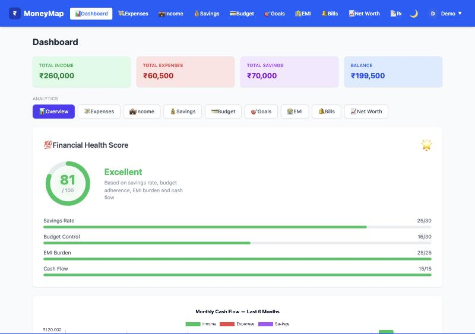
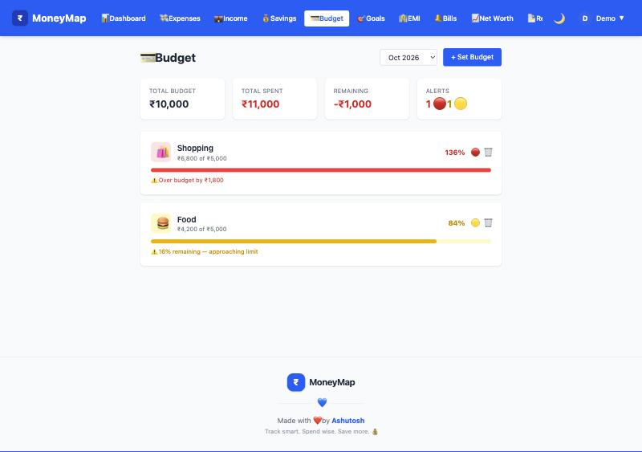
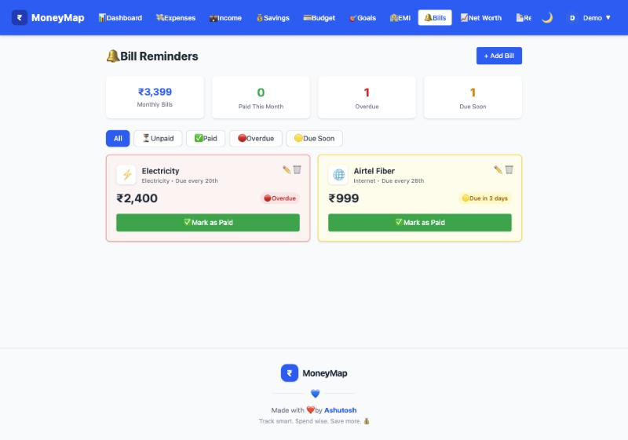
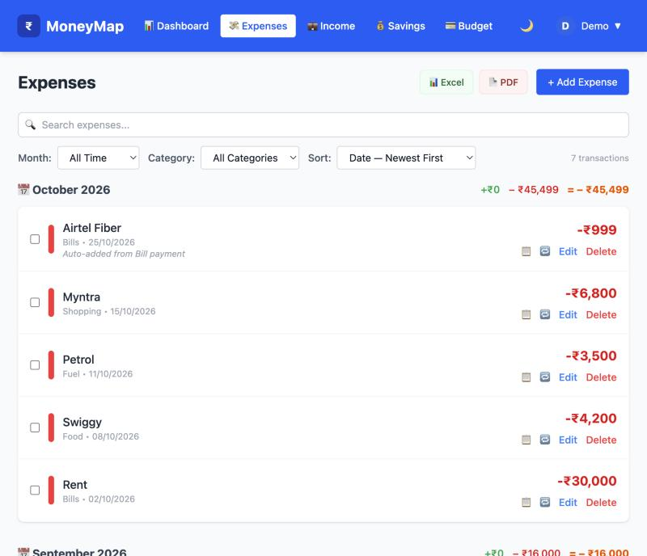
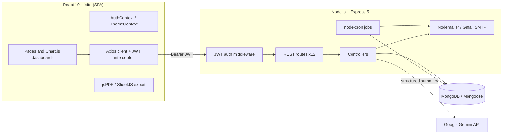

# MoneyMap: Personal Finance Tracker

A full-stack **MERN** app for managing your money in one place. It tracks expenses, income and savings, plus the recurring commitments that usually live in separate apps or spreadsheets: monthly budgets, savings goals, loan EMIs, utility bills and net worth. On top of that data it gives you scheduled email alerts, downloadable reports, a 0–100 **Financial Health Score** and **AI-generated insights** (Google Gemini).

Built for the Indian context: amounts in ₹ with Indian digit grouping (₹1,25,000), EMI-based loans, and bill categories like OTT, Rent and Credit Card.

**Live demo:** https://expense-tracker-five-omega-32.vercel.app

**API:** https://moneymap-api-v1q2.onrender.com (free tier: the first request after about 15 minutes idle takes 30–60 seconds while the server wakes up)



| Budget alerts | Bill reminders | Expenses |
|---|---|---|
|  |  |  |

---

## 1. The problem and the use case

A typical salaried professional has money going through many channels: a salary credit, a rent transfer, an SIP, two or three EMIs, half a dozen utility and OTT bills, and daily spending on food and fuel. Most expense apps only cover the last of these. As a result, people can't easily answer:

- *"Am I about to overshoot my food budget this month?"*
- *"Which bills are due this week, and did I pay last month's on time?"*
- *"How much do I still owe on my loans, and what am I actually worth?"*
- *"Is my financial situation getting better or worse?"*

MoneyMap answers all of these from one dataset. Each module feeds the others automatically, so the user never enters the same transaction twice:

| User action | What the system does automatically |
|---|---|
| Marks a **bill** as paid | Records on-time/late status (2-day grace period) and creates a matching **Expense** |
| Marks an **EMI** as paid | Checks the instalment is actually due, adds 1 to months paid, closes the loan on the last instalment, and creates an **Expense** |
| Adds money to a **goal** | Updates progress, marks the goal complete at its target, and creates a **Saving** |
| Adds a saving or takes a loan | **Net worth** is recalculated live (savings + assets − EMI outstanding − liabilities) |
| Nothing (scheduled) | Sends daily emails for bills due soon or overdue and for budgets at ≥80% or ≥100%. Saves a monthly net-worth snapshot for the trend chart |

**Example user story:** Priya earns ₹1.2L/month, pays ₹30k rent and a ₹15k car EMI, and sets a ₹5k monthly food budget. On the 25th she gets an email saying food is at 84% and her electricity bill is overdue. She opens MoneyMap, marks the bill paid (it appears in Expenses automatically) and checks her Health Score (81/100, "Excellent"). Then she asks AI Insights to summarise her month compared with the previous one.

---

## 2. Features

| Module | Highlights |
|---|---|
| **Auth** | Register → 6-digit email OTP verification → JWT (7-day expiry). Forgot password and change password (current password + OTP). Delete account removes all of the user's data across every collection |
| **Expenses / Income / Savings** | CRUD, 10 categories each, search, filters, month grouping, pagination, bulk select and delete, **Excel and PDF export** |
| **Budget** | One limit per category per month (enforced by a unique index; saving again updates it). Live status: `safe` <80% · `warning` 80–99% · `exceeded` ≥100% |
| **Goals** | Target and deadline, add money step by step, auto-complete at target, linked savings |
| **EMI** | Tenure, interest and start date. Can't be marked paid before it's due. Outstanding amount feeds into net worth |
| **Bills** | Day-of-month due date. Status `overdue / due-today / due-soon / upcoming / paid`. 12-month punctuality history |
| **Net Worth** | Combines automatic entries (total savings, EMI outstanding) with manual assets and liabilities. Monthly history chart |
| **Dashboard** | 9 analytics tabs with 20+ Chart.js charts. Financial Health Score with a per-component breakdown |
| **Reports** | This/last month, quarter or year, or a custom range. Expenses, income, savings or everything combined. Current snapshot of budgets, goals, EMIs, bills and net worth. PDF and Excel download |
| **AI Insights** | Gemini comments on spending, budgets, savings, goals, bills and EMIs, net worth, the health score and trends, compared with the previous period |
| **UX** | Dark mode, responsive layout and navbar, skeleton loaders, empty states, confirmation modals, toasts |

### Financial Health Score (0–100)

| Component | Max | Rule |
|---|---|---|
| Savings rate | 30 | `min(30, savingsRate / 20% × 30)`. A 20% savings rate earns full marks |
| Budget control | 30 | Start at 30, −10 per exceeded budget, −4 per warning |
| EMI burden | 25 | EMI/income ≤20% → 25 · ≤40% → 15 · >40% → 5 |
| Cash flow | 15 | 15 if income ≥ expenses, else 0 |

---

## 3. Architecture



**Backend layout** (`backend/`)

```
app.js              Express app: middleware + route mounting (imported by tests)
server.js           Entry point: loads .env, connects DB, starts crons, listens
config/db.js        Mongoose connection
middleware/         JWT verification -> req.user
models/             11 Mongoose schemas
routes/             12 routers, one per module
controllers/        Business logic
services/           emailService (HTML templates), cronService (3 schedules)
utils/              pickFields (PUT allow-lists), sendError (400 vs 500)
tests/              Jest + Supertest suite (in-memory MongoDB)
```

**Frontend layout** (`frontend/src/`)

```
pages/        19 route-level screens (Dashboard, Expenses, ..., AIInsights)
components/   Charts, DashboardCharts, DueCalendar, Pagination, BulkActions, ...
hooks/        useSearch, usePagination, useBulkSelect
context/      AuthContext (token + user in localStorage), ThemeContext (dark mode)
services/     exportService (PDF with branded header/footer, Excel)
api/axios.js  Axios instance with Bearer-token interceptor
```

### Tech stack

| Layer | Technology |
|---|---|
| Frontend | React 19, React Router 7, Vite 8, Tailwind CSS 4, Chart.js 4, react-hot-toast, jsPDF + autoTable, SheetJS |
| Backend | Node.js, Express 5, Mongoose 9, JSON Web Tokens, bcryptjs, node-cron, Nodemailer (local) / Brevo HTTPS API (production) |
| Database | MongoDB (TTL index for OTPs, unique compound indexes for budgets and snapshots) |
| AI | Google Gemini (`@google/generative-ai`) |
| Testing | Jest 30, Supertest, mongodb-memory-server, Vitest 5, React Testing Library, jsdom |

---

## 4. Engineering decisions worth discussing

1. **Compute first, then let the model explain.** The AI endpoint never sends raw transactions to the LLM. `buildSummary()` first works out totals, comparisons with the previous period, budget statuses, goal progress, EMI-to-income ratio, bill punctuality and the health score. Only that summary goes to Gemini. This keeps the prompt small, keeps the numbers exact, and limits how much financial data leaves the server.
2. **LLM guardrails.** The prompt tells the model to describe rather than advise ("NEVER prescriptive", no investment advice), to quote real numbers, to label predictions as trend-based estimates, and to return strict JSON. The server strips Markdown code fences before parsing. If parsing fails it returns a clean 500 instead of passing broken output to the UI.
3. **Resilience.** Gemini calls are retried with linear backoff (2s, then 4s) on 503/"overloaded" errors. Other errors fail immediately. Cron jobs wrap each user in its own try/catch, so one failed email doesn't stop everyone else's alerts.
4. **Using the database to enforce rules:**
   - The OTP model uses a TTL index (`expireAfterSeconds: 0` on `expiresAt`), so MongoDB deletes expired codes after 10 minutes without any cleanup code.
   - A unique index on `{userId, category, month}` plus `findOneAndUpdate({upsert:true})` makes "set budget" idempotent.
   - A unique index on `{userId, month}` means the monthly snapshot can safely run more than once.
5. **Linked records instead of duplicate entry.** Bill, EMI and goal payments create expense or saving records tagged with a fixed `notes` marker. A `/linked` endpoint counts them, so the UI can warn *"this bill has 3 linked expenses (₹2,997)"* before the user deletes it.
6. **Snapshot timing.** The net-worth cron runs at 06:00 on the 1st but saves the snapshot under the previous month's label. That way the history chart shows each month's closing value. If it used the current month, the month that just ended would disappear from the chart.
7. **Safe account deletion.** All data collections are deleted in parallel first, and the `User` document is deleted last. If anything fails partway, the account still exists and the user can try again, rather than being left with orphaned data.
8. **Per-user data isolation.** Every query includes `userId: req.user.id` taken from the verified JWT, never from the request body. The tests check that one user can't read, edit or delete another user's records in any module.
9. **Edit endpoints only accept known fields.** Each `PUT /:id` passes the body through `utils/pickFields.js` with a per-model allow-list (for example `EXPENSE_EDITABLE_FIELDS`), and the update runs with `runValidators: true`. A client therefore can't move a record to another user (`userId`), forge bill payment history, skip EMI instalments (`paidMonths`) or mark a goal complete (`currentAmount`, `isCompleted`). Edits are also checked against the same schema rules as new records.
10. **Correct status codes.** `utils/sendError.js` returns **400** for Mongoose `ValidationError` and `CastError` (bad input, malformed ids) and **500** for everything else. The frontend shows the server's message in its save error toasts (`err.response?.data?.message || fallback`), so users see the actual reason a save failed.

---

## 5. Data model

| Collection | Key fields | Notes |
|---|---|---|
| `User` | name, email (unique), password (bcrypt), isEmailVerified, avatarColor | |
| `OTP` | email, otp, type (`email-verify` / `forgot-password` / `change-password`), used, expiresAt | TTL index, single-use |
| `Expense` | title, amount, type (`income`/`expense`), category (10), date, notes | |
| `Income` | title, amount, category (Salary, Freelance, Dividends, …), date | |
| `Saving` | title, amount, category (FD, Stocks, Gold, PPF, Crypto, …), date | |
| `Budget` | category, limit, month (`"Oct 2026"`) | unique `{userId, category, month}` |
| `Goal` | title, targetAmount, currentAmount, deadline, isCompleted | |
| `EMI` | totalAmount, emiAmount, interestRate, tenureMonths, paidMonths, startDate, isActive | |
| `Bill` | amount, dueDate (1–31), category, lastPaidMonth, paymentHistory[≤12] | |
| `NetWorth` | name, value (≥0), type (`asset`/`liability`) | manual entries |
| `NetWorthHistory` | month, netWorth, totalAssets, totalLiabilities | unique `{userId, month}` |

---

## 6. REST API

All routes except the public auth routes need `Authorization: Bearer <jwt>`.

| Module | Endpoints |
|---|---|
| Auth (public) | `POST /api/auth/register` · `login` · `verify-email` · `resend-otp` · `forgot-password` · `reset-password` |
| Auth (protected) | `POST /api/auth/send-change-password-otp` · `POST /api/auth/change-password` · `DELETE /api/auth/delete-account` |
| Expenses | `GET/POST /api/expenses` · `PUT/DELETE /api/expenses/:id` · `DELETE /api/expenses/bulk` · `GET /api/expenses/stats` · `GET /api/expenses/category-month` |
| Income | `GET/POST /api/income` · `PUT/DELETE /api/income/:id` · `DELETE /api/income/bulk` · `GET /api/income/stats` |
| Savings | `GET/POST /api/saving` · `PUT/DELETE /api/saving/:id` · `DELETE /api/saving/bulk` · `GET /api/saving/stats` |
| Budget | `GET /api/budget?month=Oct 2026` · `POST /api/budget` (upsert) · `DELETE /api/budget/:id` |
| Goals | `GET/POST /api/goals` · `PUT /api/goals/:id/addmoney` · `GET /api/goals/:id/linked` · `PUT/DELETE /api/goals/:id` |
| EMI | `GET/POST /api/emi` · `PUT /api/emi/:id/paid` · `GET /api/emi/:id/linked` · `PUT/DELETE /api/emi/:id` |
| Bills | `GET/POST /api/bills` · `PUT /api/bills/:id/paid` · `GET /api/bills/:id/linked` · `PUT/DELETE /api/bills/:id` |
| Net worth | `GET /api/networth` · `GET /api/networth/history` · `POST /api/networth` · `PUT/DELETE /api/networth/:id` |
| Reports | `GET /api/reports/generate?periodType=&type=&startDate=&endDate=` · `GET /api/reports/snapshot` |
| AI | `GET /api/ai-insights/generate?periodType=&startDate=&endDate=` |
| Profile | `GET /api/profile` (user + record counts) · `PUT /api/profile` |

`periodType` is one of `this-month`, `last-month`, `this-quarter`, `last-quarter`, `this-year`, `last-year` or `custom`. `type` is one of `expenses`, `income`, `savings` or `all`.

**Scheduled jobs** (`services/cronService.js`)

| Cron | When | Job |
|---|---|---|
| `0 9 * * *` | Daily 09:00 | Emails each user a list of unpaid bills that are overdue, due today or due within 3 days |
| `15 9 * * *` | Daily 09:15 | Emails each user their budgets at ≥80% (warning) or ≥100% (exceeded) for the current month |
| `0 6 1 * *` | 1st of month 06:00 | Saves every user's net-worth snapshot for the month that just ended |

---

## 7. Testing

**106 automated tests, all passing.** Backend line coverage is 91.5% (the uncovered lines are mostly generic `catch → 500` handlers). `npm run lint` and `npm run build` both pass cleanly.

```bash
cd backend && npm test               # 94 API/integration/unit tests (Jest + Supertest)
cd backend && npm run test:coverage  # with coverage report
cd frontend && npm test              # 12 unit tests (Vitest + React Testing Library)
```

### How the tests are isolated

- **No real infrastructure.** Each backend test file starts its own **in-memory MongoDB** (`mongodb-memory-server`) and wipes every collection between tests. The Gmail service and the Gemini SDK are replaced with Jest mocks (`tests/mocks/`). `tests/setupEnv.js` sets test-only secrets, so `.env` is never read and no real emails are sent.
- **Fixed clock.** Bill status, EMI due dates, 6-month stats windows, quarter boundaries and cron jobs all depend on today's date. Tests freeze `Date` (`freezeDate()` in `tests/helpers.js`) but keep real timers running, so the MongoDB driver still works.
- **Real HTTP path.** Tests call the actual Express app through Supertest and register and verify users through the real OTP flow. They don't seed tokens directly.

### What is covered

| Suite | Tests | Scenarios |
|---|---|---|
| `auth.test.js` | 17 | Password hashing; OTP format, wrong OTP, single use, 10-minute TTL; JWT 7-day expiry; same error message for unknown email and wrong password; unverified login → 403 + new OTP; forged, garbage and expired tokens → 401; forgot/reset and change-password flows; account deletion removes all 9 collections and leaves other users untouched |
| `transactions.test.js` | 27 | CRUD + newest-first ordering for expenses, income and savings; **cross-user isolation** (read, edit, delete, bulk delete); 404s; enum and required-field validation (400); **PUT ignores `userId`/`_id`** for each module; edits are schema-validated; malformed ids → 400; 6-month stats with category percentages and income/expense split; budget thresholds (50% safe / 80% warning / 120% exceeded), month scoping, upsert, owner-only delete |
| `planning.test.js` | 22 | Bill status from day of month, sort order, on-time vs late with 2-day grace, category mapping (OTT → Entertainment), no double payment, linked-expense matching, 12-month history cap; EMI monthly payments, early-payment refusal, loan closure, "already fully paid"; goal money cap and auto-complete, amounts `"abc"`/0/negative/missing → 400, isolation; net-worth formula; snapshot month label, safe re-runs, chronological history; **edit protection**: bill payment history, EMI `paidMonths`/`isActive` and goal progress can't be forged, EMI and net-worth edits are validated |
| `insights.test.js` | 14 | Report periods (this/last month, this year, last year, custom with inclusive end date, **last quarter in January rolling back to Q4 of the previous year**); snapshot totals; AI health score (100 for a healthy profile, 51 with exceeded budgets, a heavy EMI and negative cash flow); prompt guardrails and data; code-fence stripping; unparseable output → 500; 503 retry then success; gives up after 3 attempts; non-retryable errors fail immediately; profile hides the password |
| `cron.test.js` | 5 | All 3 schedules registered; bill reminders limited to the right bills and grouped per user; budget alerts only at ≥80%; one user's SMTP failure doesn't stop others; monthly snapshot for every user |
| `emailService.test.js` | 3 | With `BREVO_API_KEY` set, OTP emails go to Brevo's HTTPS API with the key, the verified sender and the rendered template; Brevo errors are thrown; without the key, the service falls back to Gmail SMTP (nodemailer) |
| `utils.test.js` | 6 | `pickFields` keeps only allow-listed, defined keys; `sendError` maps `ValidationError`/`CastError` → 400 and other errors → 500 |
| `frontend/src/__tests__` | 12 | `useSearch` (case-insensitive, multi-field, numeric), `usePagination` (page maths, empty list), `useBulkSelect` (select-all only selects the current page and keeps other pages' selections), export row formatting (₹ Indian grouping, dates, empty notes), Axios JWT interceptor |

### Manual end-to-end check

I ran the whole app in a browser against a throwaway in-memory database:

1. Register, read the OTP from the server log, verify, and land on the dashboard.
2. Add sample data and check the dashboard totals (income ₹2,60,000 − expenses ₹60,500 → balance ₹1,99,500; health score 81).
3. Check the budget page: Food at 84% shows a warning, Shopping at 136% shows exceeded.
4. Check the bills page: one bill overdue, one due in 3 days. Click **Mark as Paid**; the toast confirms *"₹999 added to Expenses"* and the new expense appears in the Expenses list.
5. Check net worth: ₹45.7L assets − ₹7.2L EMI outstanding = ₹38.5L.
6. Generate a period report; the category split includes the expense created by paying the bill.
7. After the security and lint fixes, run a second pass:
   - Edit an expense from the UI; the title and amount save, and the record still belongs to its owner.
   - Toggle dark mode; it applies and is remembered.
   - Switch budget months; the page reloads that month's budgets. This step also exposed the **"Sept" locale bug** listed under Known limitations.

The browser console showed no errors during this run.

---

## 8. Running locally

**Prerequisites:** Node 20+ and a MongoDB connection string (local or Atlas). Optional: a Gmail App Password (for OTP and alert emails) and a Gemini API key (for AI Insights).

```bash
# Backend
cd backend
npm install
cat > .env <<'EOF'
MONGO_URI=mongodb://localhost:27017/moneymap
JWT_SECRET=change-me
PORT=3000
GMAIL_USER=you@gmail.com
GMAIL_APP_PASSWORD=xxxx-xxxx-xxxx-xxxx
GEMINI_API_KEY=your-key
EOF
npm run dev
```

```bash
# Frontend (separate terminal)
cd frontend
npm install
echo "VITE_API_URL=http://localhost:3000/api" > .env.local
npm run dev        # http://localhost:5173
```

`VITE_API_URL` is optional. Without it, the client uses the LAN address hardcoded in `src/api/axios.js`.

### Deploying (Render + Vercel + MongoDB Atlas)

The repo includes [`render.yaml`](render.yaml) for the API and [`frontend/vercel.json`](frontend/vercel.json) for the single-page app. `vercel.json` sends every route to `index.html`, so a page refresh on `/dashboard` still loads the app.

1. **Email via Brevo.** Render's free tier [blocks outbound SMTP](https://render.com/docs/free), so the hosted app sends email through Brevo's HTTPS API (free, 300 emails/day). In Brevo, verify your sender address under Senders, then create an API key under SMTP & API → API Keys. `emailService` switches to Brevo automatically whenever `BREVO_API_KEY` is set; local development keeps using Gmail SMTP.
2. **API on Render.** Choose New → Blueprint and pick this repository. Render creates `moneymap-api` from `render.yaml`, generates `JWT_SECRET` for you, and asks for `MONGO_URI`, `BREVO_API_KEY`, `EMAIL_FROM` (the verified sender) and `GEMINI_API_KEY`.
3. **Database access.** In MongoDB Atlas, open Network Access and allow connections from Render. The free tier has no fixed outbound IP, so this usually means `0.0.0.0/0`.
4. **Frontend on Vercel.** Import the repository with Root Directory set to `frontend`. Add the environment variable `VITE_API_URL=https://<your-render-service>.onrender.com/api`, then deploy.

Free-tier caveats:
- The Render instance sleeps after about 15 minutes idle, so the first request takes around 30 seconds to wake it.
- Cron jobs only run while the instance is awake.

---

## 9. Known limitations and roadmap

These are known issues I'd address before production. They make good interview talking points.

**Already fixed:**
- **Mass assignment.** Edit endpoints used to pass `req.body` straight to the database, so a client could change `userId`, forge payment history or mark loans as paid. They now use field allow-lists plus schema validation.
- **Status codes.** Validation errors used to return 500; they now return 400 with a readable message.
- **Goal contributions.** Zero and negative amounts are now rejected.
- **Lint.** The 39 frontend lint errors are cleaned up.

The fix and the tests that prove it appear in the testing section.

**Still open:**

| Area | Current behaviour | Planned fix |
|---|---|---|
| **OTP brute force and enumeration** | No limit on OTP attempts or requests. Forgot-password and resend reveal whether an email is registered | `express-rate-limit`, a per-OTP attempt counter, the same response for every email |
| **Token storage and CORS** | JWT kept in `localStorage`; `cors()` allows any origin | httpOnly cookie plus CSRF protection, or short-lived access token with refresh; allow only known origins |
| **Goal over-contribution** | The goal stops at its target, but the full amount is still saved as a Saving (adding ₹800 to a goal that needs ₹600 records ₹800) | Record only the amount actually applied, or show the overflow to the user |
| **Locale-dependent month labels** | Months are stored as strings like `"Sep 2026"`, built with `toLocaleString("default")` on both client and server. In an **en-IN or en-GB browser, September is written "Sept 2026"**, so a September budget set from the UI never matches the server's spending totals or budget alerts. Confirmed in the browser during testing | Use a fixed locale (`"en-US"`) in one shared helper, or store months as `YYYY-MM` |
| **Aggregation** | Stats load all of a user's documents and group them in JavaScript, using the server's time zone | MongoDB aggregation pipelines with `$dateToString` and an explicit time zone; indexes on `{userId, date}` |
| **Crons inside the API process** | Running more than one server instance would send duplicate emails | Distributed lock, or a separate worker/queue (BullMQ) |
| **Bundle size** | The main bundle is about 1.5 MB | Load routes on demand with `React.lazy` and lazy-load Chart.js and jsPDF |

---

## 10. Resume summary

**MoneyMap: Full-stack personal finance platform** (React, Node.js, Express, MongoDB, Gemini AI)

- Built a MERN app with 11 data models and 50+ REST endpoints covering expenses, income, savings, budgets, goals, EMIs, bills and net worth. Modules link to each other: paying a bill, EMI or goal creates the matching ledger entry automatically.
- Added secure authentication with bcrypt, JWT and email OTP verification. One-time codes are single-use and expire automatically through a MongoDB TTL index.
- Built an AI insights feature that computes a deterministic financial summary and health score on the server and sends only that summary to Google Gemini. The prompt enforces no-advice rules and strict JSON output, and 503 errors are retried with backoff.
- Automated daily bill and budget email alerts and monthly net-worth snapshots with node-cron and Nodemailer, with errors isolated per user.
- Built an analytics dashboard with 20+ Chart.js charts, a 0–100 Financial Health Score, and PDF/Excel report export for any time period.
- Wrote 106 automated tests (Jest, Supertest, in-memory MongoDB, Vitest) reaching 91% backend line coverage, using a frozen clock to test date-dependent logic.
- Found and fixed a mass-assignment vulnerability: edit endpoints now accept only allow-listed fields, run schema validators, and return 400 for invalid input.
