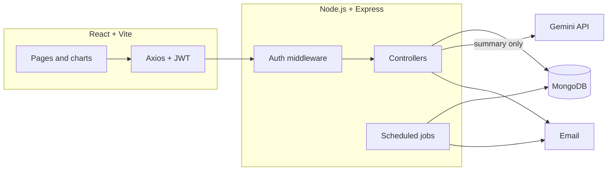

# MoneyMap

A personal finance tracker that keeps all your money in one place: expenses, income, savings, budgets, goals, loan EMIs, recurring bills and net worth.

**Live demo:** https://expense-tracker-five-omega-32.vercel.app

> The backend runs on Render's free tier, so if nobody has used it for a while, the first request can take 30–60 seconds while the server wakes up. After that it's quick.


| Budgets | Bill reminders | Expenses |
|---|---|---|
|  |  |  |

## Why I built this

Most expense apps are good at one thing: logging what you spent on lunch. But that's only a small part of where a salary actually goes. Every month there's rent, a couple of EMIs, an SIP, electricity, internet, a few OTT subscriptions, and then the day-to-day spending on top. Keeping track of all that usually means a spreadsheet plus three different apps.

I wanted one place that could answer the questions I actually care about:

- Am I about to blow my food budget this month?
- Which bills are due this week, and did I pay last month's on time?
- How much do I still owe on my loans, and what am I really worth?
- Is my overall financial situation getting better or worse?

MoneyMap is built around Indian personal finance, so amounts are in ₹ with Indian digit grouping (₹1,25,000), loans are tracked as EMIs, and bill categories include things like OTT, Rent and Credit Card.

## What it does

- **Expenses, income and savings.** Add, edit, search and filter entries, select several at once to delete them, and export everything to Excel or PDF.
- **Budgets.** Set a monthly limit per category. Each one shows as safe, warning (80% used) or exceeded (100% or more).
- **Goals.** Save towards a target with a deadline. Each contribution is also recorded as a saving.
- **EMIs.** Track each loan's tenure and instalments. You can't mark an instalment paid before it's due, and the remaining balance counts towards your net worth.
- **Bills.** Recurring bills with a due day. Each one shows as overdue, due today, due soon or paid, and the app keeps a 12-month record of whether you paid on time.
- **Net worth.** Your savings and manual assets, minus outstanding EMIs and other liabilities, with a monthly history chart.
- **Dashboard.** 9 analytics tabs with more than 20 charts, plus a Financial Health Score from 0 to 100.
- **Reports.** Pick a month, quarter, year or custom range and download it as a PDF or Excel file.
- **AI Insights.** A plain-English summary of your month from Google Gemini, compared with the previous period.
- **Email alerts.** A daily email for bills that are due or overdue and for budgets that are close to or over their limit.
- **Accounts.** Sign-up with email OTP verification, password reset, and account deletion that removes all your data.

The modules feed into each other so you never enter the same thing twice. Paying a bill or an EMI creates the matching expense automatically, adding money to a goal creates a saving, and net worth updates on its own.

### How the health score works

| Part | Points | How it's scored |
|---|---|---|
| Savings rate | 30 | Full marks at a 20% savings rate, scaled down below that |
| Budget control | 30 | Starts at 30. Each exceeded budget costs 10 points, each warning costs 4 |
| EMI burden | 25 | 25 if EMIs are up to 20% of income, 15 if up to 40%, 5 above that |
| Cash flow | 15 | 15 if you earned more than you spent, otherwise 0 |

## Tech stack

| | |
|---|---|
| Frontend | React 19, React Router 7, Vite, Tailwind CSS 4, Chart.js, jsPDF, SheetJS |
| Backend | Node.js, Express 5, Mongoose, JWT, bcrypt, node-cron |
| Database | MongoDB Atlas |
| Email | Brevo API in production, Gmail SMTP for local development |
| AI | Google Gemini |
| Testing | Jest, Supertest, mongodb-memory-server, Vitest, React Testing Library |
| Hosting | Vercel (frontend), Render (API) |



## A few design decisions

**The AI never sees raw transactions.** Before calling Gemini, the server works out all the numbers itself: totals, comparisons with the previous period, budget status, goal progress, EMI-to-income ratio and the health score. Only that summary is sent to the model. That keeps the prompt small, makes sure the numbers in the insights are exact, and keeps individual transactions on the server. The prompt also tells the model to describe rather than advise, to quote real figures, and to reply in strict JSON. If the response can't be parsed, the API returns a clean error instead of passing broken output to the UI.

**The database enforces some rules itself.** OTP codes expire through a MongoDB TTL index, so there's no cleanup job. Budgets have a unique index on user, category and month, so saving the same budget twice updates it instead of creating a duplicate. Net-worth snapshots work the same way, so the monthly job can safely run more than once.

**Every request is scoped to the logged-in user.** Each query filters by the user ID from the verified JWT, never by anything in the request body. Edit endpoints only accept an allow-list of fields, so a client can't, for example, move a record to another account or mark an EMI as fully paid. Invalid input gets a 400 with a readable message, not a generic 500.

**The monthly snapshot is saved under the previous month.** The net-worth job runs early on the 1st, but it records the result as the month that just ended. That way the history chart shows each month's closing value.

**Account deletion is ordered carefully.** All of the user's data is deleted first and the user record last. If something fails partway through, the account still exists and the user can simply try again.

**Email goes over HTTPS in production.** Render's free tier blocks outgoing SMTP, so the hosted app sends email through Brevo's API. When no Brevo key is set, the same code falls back to Gmail SMTP, which keeps local development simple.

## Running it locally

You'll need Node 20+ and a MongoDB connection string (local or Atlas). A Gmail app password and a Gemini API key are optional; without them, email and AI Insights won't work but everything else will.

```bash
# Backend
cd backend
npm install
cp .env.example .env    # then fill in your values
npm run dev
```

```bash
# Frontend, in a second terminal
cd frontend
npm install
echo "VITE_API_URL=http://localhost:3000/api" > .env.local
npm run dev             # opens on http://localhost:5173
```

## Deployment

The repo includes [`render.yaml`](render.yaml) for the API and [`frontend/vercel.json`](frontend/vercel.json) for the frontend. Pushing to `main` redeploys both.

1. **Brevo:** create a free Brevo account, verify a sender address, and generate an API key.
2. **Render:** create a new Blueprint from this repo. Render reads `render.yaml`, generates `JWT_SECRET`, and asks for `MONGO_URI`, `BREVO_API_KEY`, `EMAIL_FROM` and `GEMINI_API_KEY`.
3. **MongoDB Atlas:** under Network Access, allow connections from Render. On the free tier this means `0.0.0.0/0`.
4. **Vercel:** import the repo with the root directory set to `frontend`, and set `VITE_API_URL` to your Render URL followed by `/api`.

## Author

Built by **Ashutosh Tewari** · [GitHub](https://github.com/ashutosh081201)
